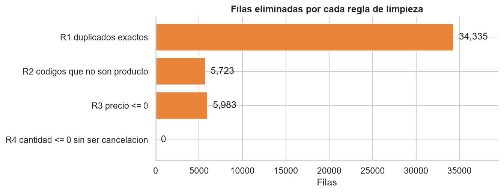
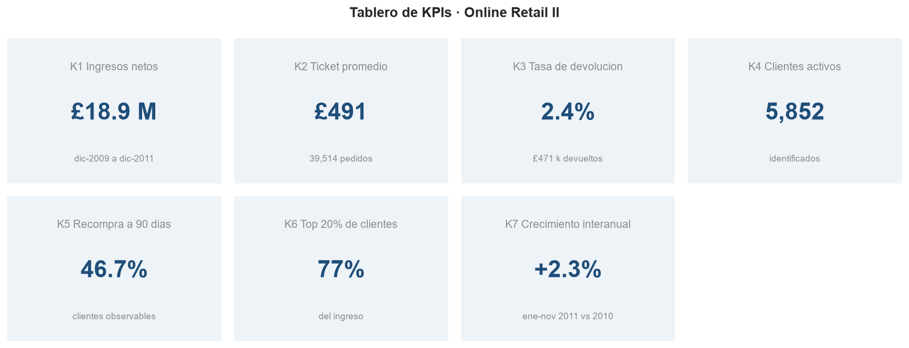
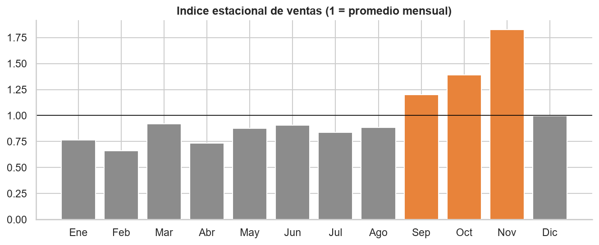
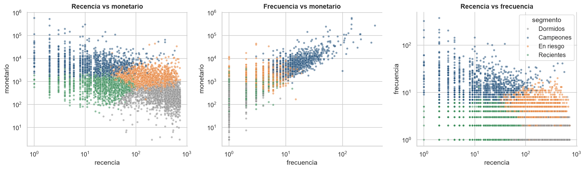
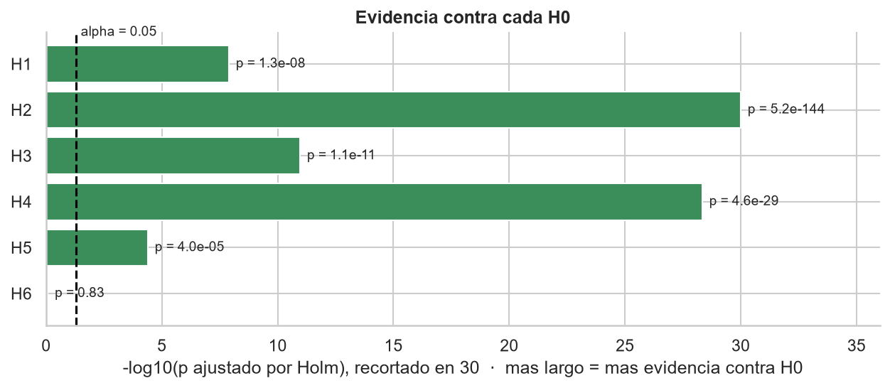

# Análisis de E-commerce con Business Intelligence · Grupo 3

**Evento Evaluativo 3 · Análisis de Datos · Ingeniería de Sistemas · ITM 2026-2**
Docente: Daniel Alexis Nieto Mora · Proyecto asignado: **Equipo 3 — E-commerce**

| Integrante | Usuario de GitHub |
|---|---|
| Santiago Betancur | [@Xantyagoh](https://github.com/Xantyagoh) |
| Diego Alzate | [@DiegoA1123](https://github.com/DiegoA1123) |
| Carlos Mendez | [@carmarisx](https://github.com/carmarisx) |
| Sebastian Cadavid | [@Exmen9](https://github.com/Exmen9) |
| Daniel Martinez | [@danielmmnez](https://github.com/danielmmnez) |

---

## Objetivo

Convertir las transacciones de una tienda en línea mayorista en **información útil para la toma de decisiones**, mediante un modelo de datos, indicadores (KPIs), **pruebas de hipótesis** y un **dashboard en Power BI**, para responder:

1. ¿Cómo evolucionan las ventas y qué tan fuerte es la estacionalidad?
2. ¿Qué tan concentrados están los ingresos en pocos clientes, productos y países?
3. ¿Qué proporción de clientes vuelve a comprar y qué diferencia a quienes lo hacen?
4. ¿Qué tan grandes son las devoluciones y dónde se concentran?
5. ¿Los clientes del exterior se comportan distinto a los del Reino Unido?

## Dataset

**Online Retail II** (UCI Machine Learning Repository, id 502 · [DOI 10.24432/C5CG6D](https://doi.org/10.24432/C5CG6D) · CC BY 4.0): 1.067.371 líneas de factura de una tienda en línea del Reino Unido entre dic-2009 y dic-2011. Más detalle en [`data/README.md`](data/README.md).

## Metodología

El proyecto sigue las 6 fases del enunciado; cada fase tiene su notebook o entregable:

| Fase | Qué se hace | Dónde |
|---|---|---|
| 1. Comprensión del problema | Contexto, problema de negocio, 5 preguntas clave, auditoría de calidad | `notebooks/01_comprension_problema.ipynb` |
| 3. Preparación y modelado | Limpieza con trazabilidad, atípicos, variables, modelo en estrella | `notebooks/02_preparacion_modelado.ipynb` |
| 1-2. Exploración | EDA univariado y multivariado, segmentación RFM, cohortes | `notebooks/03_eda.ipynb` |
| 2 y 6. Hipótesis y validación | 6 hipótesis (H0/H1), supuestos, pruebas, tamaño del efecto, corrección de Holm | `notebooks/04_hipotesis_validacion.ipynb` |
| 4. KPIs | 7 KPIs con fórmula, justificación e interpretación | `notebooks/05_kpis.ipynb` |
| 5. Dashboard | Power BI de 6 páginas (incluye dashboard ejecutivo) | `dashboard/` |
| 6. Storytelling | Narrativa, decisiones propuestas y limitaciones | `docs/storytelling_y_decisiones.md` |

## Estructura del repositorio

```
├── README.md
├── requirements.txt
├── data/
│   ├── README.md              fuente, licencia y diccionario de datos
│   ├── raw/                   datos originales (no se versionan)
│   └── processed/             datos limpios, modelo en estrella, RFM, resultados
├── src/descargar_datos.py     descarga el dataset desde la UCI
├── notebooks/                 01 a 05
├── dashboard/                 .pbix, medidas DAX, tema, guía y capturas
└── docs/                      figuras y storytelling
```

## Cómo reproducir

```bash
git clone https://github.com/Xantyagoh/grupo3-bi-ecommerce.git
cd grupo3-bi-ecommerce
python -m venv venv
venv\Scripts\activate            # Mac/Linux: source venv/bin/activate
pip install -r requirements.txt
python src/descargar_datos.py    # descarga y convierte los datos (1-2 min)
jupyter notebook                 # ejecutar los notebooks 01 a 05 en orden (Restart & Run All)
```

El dashboard se abre con **Power BI Desktop** (`dashboard/grupo3_ecommerce.pbix`); si se pide actualizar datos, apuntar la carpeta `data/processed/modelo_bi/`.

## Resultados

### Datos y preparación
- **1.067.371** líneas originales → **1.021.326** después de limpiar (95,7 %). Se eliminaron duplicados exactos (34.335), códigos que no son producto (5.723), precios ≤ 0 (5.983) y 4 líneas de dos pedidos gigantes cancelados a los minutos.
- Las **cancelaciones se conservan** como devoluciones. Las líneas **sin cliente** (22 %) se conservan para ventas y se excluyen del análisis por cliente.
- Modelo en estrella: `fact_lineas` + `dim_fecha`, `dim_producto`, `dim_cliente`, `dim_pais`.



### KPIs

| KPI | Valor |
|---|---|
| K1 Ingresos netos | **£18,93 M** (ventas £19,40 M − devoluciones £0,47 M) |
| K2 Ticket promedio | **£491** por pedido (mediana £301) · 39.514 pedidos |
| K3 Tasa de devolución | **2,4 %** del valor vendido |
| K4 Clientes activos | **5.852** identificados |
| K5 Recompra a 90 días | **46,7 %** |
| K6 Concentración (20 % de clientes) | **77 %** del ingreso |
| K7 Crecimiento interanual (ene–nov) | **+2,3 %** |



### Hallazgos del análisis exploratorio
- **Estacionalidad fuerte:** septiembre–noviembre = 1,2 / 1,4 / 1,8 veces el mes promedio.
- **Concentración (80/20):** el 20 % de clientes aporta 77 % del ingreso; el 20 % de productos, 78 %; el Reino Unido, 85 %.
- **Patrón de compra:** ~75 % de las ventas entre 10:00 y 15:59; jueves el día más fuerte; casi sin ventas los sábados.
- **Segmentos RFM (k = 4):** *Campeones* (20 % de clientes, 74 % del ingreso), *En riesgo*, *Recientes* y *Dormidos*.




### Hipótesis (α = 0,05, corrección de Holm)

| H | Pregunta | Decisión | Efecto |
|---|---|---|---|
| H1 | Ingresos semanales: temporada alta > resto | **Rechaza H0** (p ≈ 1×10⁻⁸) | **Grande** (r = 0,76) · ×1,69 |
| H2 | Valor del pedido: Exterior ≠ Reino Unido | **Rechaza H0** | Pequeño (r = 0,27) · mediana £421 vs £295 |
| H3 | Devoluciones: Exterior ≠ Reino Unido | **Rechaza H0** | **Trivial** (V = 0,03) |
| H4 | Primer pedido mayor → recompra | **Rechaza H0** | Pequeño (r = 0,18) · OR = 1,44 |
| H5 | Recompra: captados en temporada alta ≠ resto | **Rechaza H0** | Pequeño: −7,6 pp (40,5 % vs 48,2 %; h de Cohen = −0,15, bajo el umbral de 0,2 pero relevante en puntos de recompra) |
| H6 | Recompra: Exterior ≠ Reino Unido | **No rechaza H0** (p = 0,83) | Trivial |



### Dashboard
Power BI de 6 páginas (resumen ejecutivo, ventas y estacionalidad, clientes y retención, mercados y devoluciones, productos, hipótesis y decisiones), con segmentadores sincronizados, filtrado cruzado, tooltips y navegación. Archivo: [`dashboard/grupo3_ecommerce.pbix`](dashboard/grupo3_ecommerce.pbix) · capturas en [`dashboard/capturas/`](dashboard/capturas/) · medidas en [`dashboard/medidas_dax.md`](dashboard/medidas_dax.md).

## Conclusiones

1. **La estacionalidad es el factor dominante:** la temporada alta (sep–nov) vende 1,7 veces más por semana. La planeación de inventario y marketing debe empezar en agosto.
2. **El ingreso depende de pocos clientes:** el 20 % de los clientes genera ~74–77 % del ingreso. Cuidar a los *Campeones* y reactivar a los clientes *En riesgo* es la palanca más rentable.
3. **El crecimiento está estancado (+2,3 %) y la retención es el cuello de botella:** solo 46,7 % de los clientes recompra en 90 días, y los captados en temporada alta recompran menos (−7,6 pp).
4. **El mercado de exportación es más valioso por pedido (+43 %) pero no más leal ni significativamente más problemático:** la diferencia en devoluciones es real pero trivial.
5. **Las devoluciones no son el problema** (2,4 % del valor). Más preocupante es que el 22 % de las líneas no tiene cliente identificado.
6. **Significancia no es relevancia:** con 40.000 pedidos casi todo es significativo; por eso las decisiones se basan en el tamaño del efecto (H1 grande; H3 trivial).

Detalle de la narrativa, las decisiones propuestas y las **limitaciones** en [`docs/storytelling_y_decisiones.md`](docs/storytelling_y_decisiones.md).

## Video explicativo

_(se agrega el enlace al final del proyecto)_

## Referencias

- Chen, D. (2019). *Online Retail II* [Dataset]. UCI Machine Learning Repository. https://doi.org/10.24432/C5CG6D
